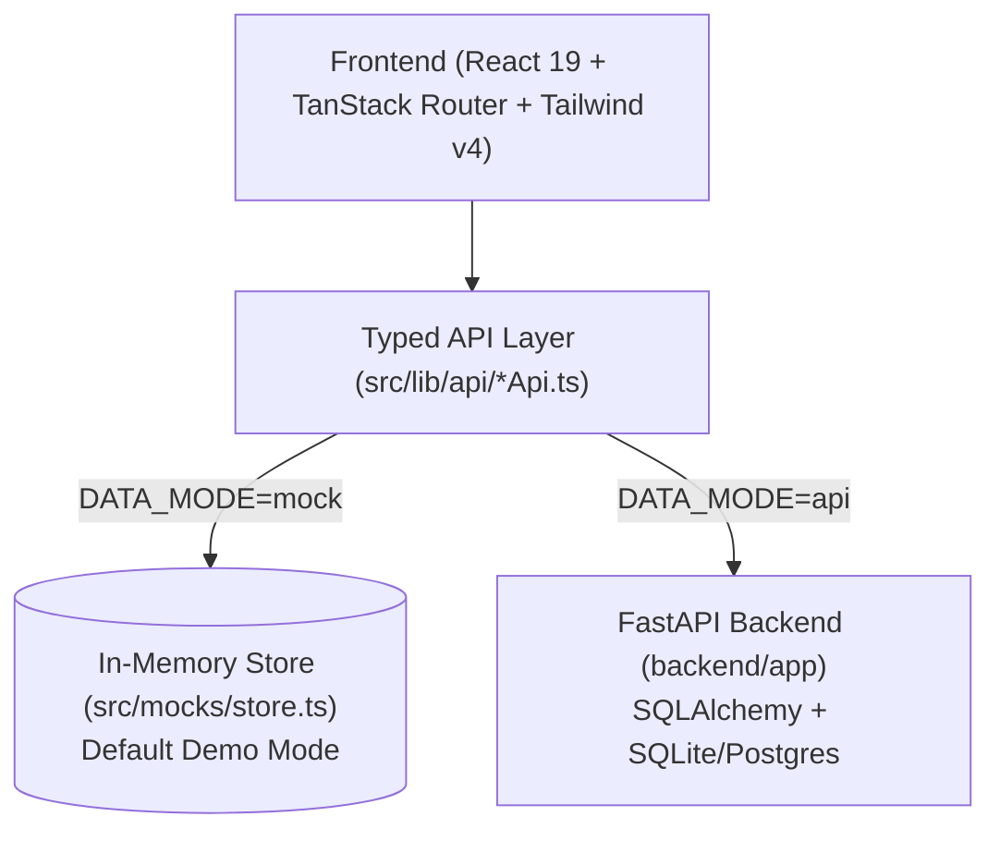

<div align="center">

# 🌊 Ripple

**Next-Gen Working Capital Resilience & Supply-Chain Contagion Platform**

*Stop guessing cash flow. Model dependency networks, simulate stress shocks, and deploy automated financial rescues.*

[](https://react.dev/)
[](https://www.typescriptlang.org/)
[](https://tanstack.com/router)
[](https://tailwindcss.com/)
[](https://fastapi.tiangolo.com/)
[-orange.svg?style=flat-square)](#-financial-integrity--design-rules)

</div>

---

## 📌 Overview

Traditional SME ERPs and accounting systems treat invoices and vendors as isolated ledger rows. When a supplier delays raw materials or a major buyer defaults on an invoice, traditional systems only show the damage **after** the business runs out of cash.

**Ripple** bridges the gap between **supply chain operations** and **treasury liquidity**. It constructs a living, interactive dependency graph of counterparties and orders, stress-tests cascading risks via a deterministic **Contagion Engine**, and models financial rescues to keep operations solvent.

---

## ✨ Key Features

### 1. 🔬 The Ripple Simulator (`/simulator`)
- **Stress-Test Contagion**: Inject operational shocks (e.g., *Customer X pays 21 days late*, *Supplier Y prices rise 15%*, *Demand drops 30%*).
- **Domino Effect Analysis**: Automatically tracks downstream order failures, zero-cash dates, and total contagion cost across the timeline.
- **Hypothetical Rescues**:
  - **Auto-Phasing**: Breaks bulk vendor commitments into milestone-linked disbursements.
  - **Split-Escrow Settlement**: Ring-fences incoming receivables directly to Tier-1 supplier commitments.
  - **Invoice Factoring / Early Payment Discounts**: Weighs liquidity gains against capital cost.

### 2. 🕸️ Dependency Graph & Fragility Network (`/relationships`)
- Powered by `@xyflow/react` node graphs.
- Visualizes buyers, orders, suppliers, and logistics tiers.
- Computes single-point-of-failure vulnerabilities and counterparty exposure scores.

### 3. 📊 Treasury & Cash-Flow Runway (`/dashboard`, `/cash-flow`)
- Real-time forecast of inflows, outflows, and net liquidity troughs.
- Granular daily, weekly, and monthly timeline horizons.

### 4. 🤖 AI Financial Copilot & Advisory (`/insights`)
- Contextual chat assistant analyzing overdue receivables, working capital crunches, and vendor credit limits.
- Quick-action suggestion pills providing immediate scenario diagnostics.

### 5. 📦 Supply & Invoicing Core (`/suppliers`, `/customers`, `/inventory`, `/invoices`)
- Full lifecycle management for Accounts Receivable (AR) and Accounts Payable (AP).
- Decoupled physical goods fulfillment from financial settlement.

---

## 🏗️ Architecture & Tech Stack



| Layer | Technologies |
| :--- | :--- |
| **Frontend Framework** | [TanStack Start](https://tanstack.com/start) / Vite 8 / React 19 / TypeScript 5.8 |
| **Routing & Querying** | TanStack Router (file-based routing) & TanStack Query v5 |
| **Interactive Graphs** | `@xyflow/react` (React Flow), Recharts |
| **Styling & UI** | Tailwind CSS v4 (OKLCH tokens), Radix UI primitives, Lucide Icons |
| **Backend & DB** | FastAPI (Python 3.11+), SQLAlchemy 2.0, Alembic, Uvicorn, Pydantic v2 |
| **Precision Math** | Strict Integer Arithmetic (All currencies held in integer minor units / paise) |

---

## ⚡ Quick Start

### Prerequisites
- **Node.js** (v18+) & **npm**
- **Python** (3.10+) *(Optional if running in mock mode)*

### 1. Clone & Install Frontend
```bash
git clone <repo-url>
cd 404NotFound
npm install
```

### 2. Run the App

#### Mode A: Standalone Demo (Instant — No Backend Required)
By default, `VITE_DATA_MODE="mock"` is enabled. The app boots immediately with the rich "Rupi Clothing" business dataset:
```bash
npm run dev
```
Open **[http://localhost:5173](http://localhost:5173)** in your browser.

---

#### Mode B: Full Stack (Frontend + FastAPI Backend)

**Terminal 1 — Backend:**
```bash
cd backend
python -m venv venv
# Windows:
.\venv\Scripts\activate
# macOS/Linux:
source venv/bin/activate

pip install -r requirements.txt
python run.py
```
> FastAPI server starts at `http://localhost:8000`.

**Terminal 2 — Frontend (Pointing to Live API):**

Configure the frontend to connect to the backend by creating or updating `.env` in the project root:

```bash
# Create or edit .env in project root:
VITE_DATA_MODE=api
VITE_API_BASE_URL=http://127.0.0.1:8000
```

> **Configuration Options:**
> - `VITE_DATA_MODE`: Set to `api` for live FastAPI backend or `mock` for in-memory standalone demo.
> - `VITE_API_BASE_URL`: Base URL of the running FastAPI server (defaults to `http://127.0.0.1:8000`).

Start the frontend development server:
```bash
# Windows (PowerShell):
$env:VITE_DATA_MODE="api"; $env:VITE_API_BASE_URL="http://127.0.0.1:8000"; npm run dev

# macOS / Linux:
VITE_DATA_MODE=api VITE_API_BASE_URL=http://127.0.0.1:8000 npm run dev

# Or with .env file configured:
npm run dev
```

---

## 📂 Project Structure

```
├── backend/                  # FastAPI Application
│   ├── app/
│   │   ├── api/              # Routers (cash flow, simulation, counterparties, invoices)
│   │   ├── models/           # SQLAlchemy DB models
│   │   ├── schemas/          # Pydantic schemas
│   │   └── services/         # Simulation & financial engines
│   └── run.py                # Server runner
│
├── src/
│   ├── routes/               # TanStack Router File-Based Pages
│   │   ├── _app.dashboard.tsx       # Working Capital & Runway Overview
│   │   ├── _app.simulator.tsx       # Contagion Stress-Testing & Rescues
│   │   ├── _app.relationships.tsx   # Visual Supply Chain Dependency Graph
│   │   ├── _app.cash-flow.tsx       # Inflow/Outflow Timeline
│   │   ├── _app.insights.tsx        # AI Assistant & Insights
│   │   ├── _app.invoices.tsx        # AP/AR Invoice Lifecycle
│   │   └── _app.suppliers.tsx       # Supplier Directory & Risk Profiles
│   │
│   ├── components/           # Reusable Radix/Tailwind components
│   ├── lib/
│   │   ├── api/              # Dual-mode API connectors (mock vs REST)
│   │   ├── formatters.ts     # Currency (INR), date, and decimal helpers
│   │   └── config.ts         # Global app config
│   └── mocks/
│       ├── data.ts           # Rupi Clothing canonical seed data
│       └── store.ts          # Reactive client-side mock datastore
└── PROJECT_CONTEXT.md        # Internal developer & architectural reference
```

---

## 🛡️ Financial Integrity & Design Rules

1. **Integer Minor Units Everywhere**: All currency values are stored as integers in **paise** (`₹1.00 = 100 paise`). Floating-point arithmetic is strictly forbidden in financial calculations to eliminate rounding decay.
2. **Strict Simulation Sandbox**: Running what-if experiments or applying financial rescues in the Simulator never modifies underlying historical invoices, payments, or records. Rescues exist as distinct simulation scenario branches.
3. **Decoupled Goods & Payments**: Physical receipt of inventory and financial settlement are separate state machines, reflecting real-world commercial trade credit.

---

## 🧪 Testing & Verification

```bash
# Run unit & integration tests
npm test

# Check TypeScript types
npm run typecheck

# Verify production build
npm run build
```

---

<div align="center">
Built with precision for resilient supply chains.
</div>
