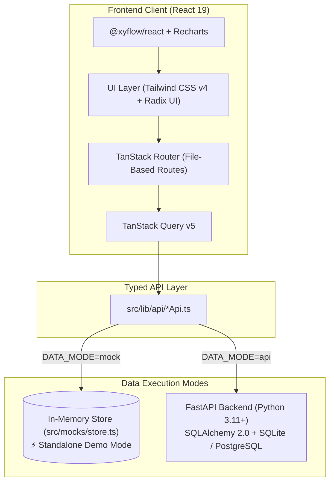

<div align="center">

# 🌊 Ripple

### **Next-Gen Working Capital Resilience & Supply-Chain Contagion Platform**

*Stop guessing cash flow. Model dependency networks, simulate stress shocks, and deploy automated financial rescues.*

<br/>

[](https://github.com/DevN5197)
[](https://github.com/DevN5197)
[](#-the-team--hackathon-milestone)

<br/>

[](https://react.dev/)
[](https://www.typescriptlang.org/)
[](https://tanstack.com/router)
[](https://tailwindcss.com/)
[](https://fastapi.tiangolo.com/)
[-f97316?style=flat-square)](#-financial-integrity--design-rules)

<br/>

[Overview](#-overview) •
[Key Features](#-key-features) •
[Architecture](#-architecture--tech-stack) •
[Quick Start](#-quick-start) •
[Project Structure](#-project-structure) •
[Financial Integrity](#-financial-integrity--design-rules) •
[The Team](#-the-team--hackathon-milestone)

---

</div>

> [!IMPORTANT]
> ### 🏆 3rd Place (2nd Runner Up) — M# 2026 @ MIT Manipal (Our Very First Hackathon!)
> This is **my personal repository** preserving our team's codebase for **Ripple**, which won **3rd Place at M# 2026** held at **MIT Manipal**.
>
> Our first hackathon was an opportunity to turn an ambitious idea into a working product: a platform that helps small and medium-sized businesses anticipate supply-chain disruptions, simulate financial stress, and protect their working capital before problems cascade.
>
> **The Team:**
> - 👨‍💻 **[Dev Nandan(me)](https://github.com/DevN5197)**
> - 👨‍💻 **[Vedant Chopade](https://github.com/Vedant7867)**
> - 👨‍💻 **[Veer Shah](https://github.com/veershah90210-alt)**
>
> *This repository is maintained as my repository of our team's project. The project and its achievement belong to the team's shared effort.*

---

## 📌 Overview

Traditional SME ERPs and accounting systems treat invoices and vendors as isolated ledger rows. When a supplier delays raw materials or a major buyer defaults on an invoice, traditional systems often reveal the damage **only after the business runs out of cash**.

**Ripple** bridges the gap between **supply-chain operations** and **treasury liquidity**. It constructs a living, interactive dependency graph of counterparties and orders, stress-tests cascading risks through a deterministic **Contagion Engine**, and models financial rescues to help businesses remain solvent.

```
┌─────────────────────────────────┐       ┌─────────────────────────────────┐
│     Supply Chain Shocks         │  ───▶ │   Deterministic Contagion       │
│  (Delays, Cost Spikes, Drops)   │       │  (Order Failures & Zero-Cash)   │
└─────────────────────────────────┘       └─────────────────────────────────┘
                                                           │
                                                           ▼
┌─────────────────────────────────┐       ┌─────────────────────────────────┐
│   Protected Working Capital     │  ◀─── │    Automated Financial Rescues  │
│  (Solvent, Resilient Business)  │       │ (Auto-Phasing, Escrows, Factor) │
└─────────────────────────────────┘       └─────────────────────────────────┘
```

---

## ✨ Key Features

### 1. 🔬 Ripple Simulator (`/simulator`)
- **Stress-Test Contagion**: Inject operational shocks in real-time:
  - ⏱️ *Customer paying 21 days late*
  - 📈 *Supplier prices rising 15%*
  - 📉 *Demand dropping 30%*
- **Domino Effect Analysis**: Automatically tracks downstream order failures, zero-cash runway dates, and total contagion costs across an interactive timeline.
- **Hypothetical Rescues**:
  - 🔄 **Auto-Phasing**: Break bulk vendor commitments into milestone-linked disbursements.
  - 🛡️ **Split-Escrow Settlement**: Ring-fence incoming receivables directly for Tier-1 supplier commitments.
  - 🏷️ **Invoice Factoring / Early Payment Discounts**: Compare liquidity gains against capital costs with zero guesswork.

### 2. 🕸️ Dependency Graph & Fragility Network (`/relationships`)
- Powered by `@xyflow/react` node graphs.
- Visualizes buyers, orders, suppliers, and multi-tier logistics relations.
- Identifies single points of failure, counterparty exposure scores, and structural bottlenecks.
- Makes hidden supply-chain vulnerabilities transparent and actionable.

### 3. 📊 Treasury & Cash-Flow Runway (`/dashboard`, `/cash-flow`)
- Real-time forecast of inflows, outflows, and net liquidity troughs.
- Supports daily, weekly, and monthly timeline horizons.
- Granular visibility into burn rate, runway days, and projected cash shortfalls.

### 4. 🤖 AI Financial Copilot & Advisory (`/insights`)
- Contextual assistant analyzing overdue receivables, working-capital crunches, and vendor credit limits.
- Quick-action suggestion pills for immediate scenario diagnostics and stress-test generation.

### 5. 📦 Supply & Invoicing Core (`/suppliers`, `/customers`, `/inventory`, `/invoices`)
- Complete lifecycle management for Accounts Receivable (AR) and Accounts Payable (AP).
- Decouples physical goods fulfillment from financial settlement to model realistic credit terms.

---

## 🏗️ Architecture & Tech Stack



| Layer | Technologies | Purpose |
| :--- | :--- | :--- |
| **Frontend Framework** | **React 19**, **Vite 8**, **TypeScript 5.8** | Next-generation UI runtime with strict typing |
| **Routing & Queries** | **TanStack Router**, **TanStack Query v5** | Type-safe file routes & resilient async state |
| **Graph Visualizations**| **`@xyflow/react`**, **Recharts** | Interactive dependency flowcharts & financial runways |
| **Styling & UI** | **Tailwind CSS v4**, **Radix UI**, **Lucide Icons** | OKLCH color design tokens & accessible primitives |
| **Backend & DB** | **FastAPI**, **Python 3.11+**, **SQLAlchemy 2.0**, **Pydantic v2** | High-performance REST API and contagion engine |
| **Financial Precision** | **Zero-Float Math** (Integer paise) | Absolute precision for all monetary calculations |

---

## ⚡ Quick Start

### Prerequisites
- **Node.js** (v18+) and **npm**
- **Python** (3.10+) *(Optional — only needed for live backend Mode B)*

### 1. Clone and Install

```bash
git clone https://github.com/DevN5197/RippleM2026.git
cd RippleM2026
npm install
```

---

### 2. Run the Application

#### 🚀 Mode A: Standalone Demo (Instant — No Backend Required)
By default, `VITE_DATA_MODE="mock"` is enabled. The application boots immediately with the comprehensive **Rupi Clothing** dataset:

```bash
npm run dev
```
Open **[http://localhost:5173](http://localhost:5173)** in your browser.

---

#### 🔌 Mode B: Full Stack (Frontend + FastAPI Backend)

**Terminal 1 — Backend:**
```bash
cd backend
python -m venv venv

# Windows (PowerShell):
.\venv\Scripts\activate

# macOS / Linux:
source venv/bin/activate

# Install dependencies & run:
pip install -r requirements.txt
python run.py
```
> FastAPI server starts at `http://localhost:8000`.

**Terminal 2 — Frontend:**
Configure your environment to connect to the FastAPI backend:

```bash
# Option 1: Edit .env in project root:
VITE_DATA_MODE=api
VITE_API_BASE_URL=http://127.0.0.1:8000
```

Start the frontend dev server:

```bash
# Windows (PowerShell):
$env:VITE_DATA_MODE="api"; $env:VITE_API_BASE_URL="http://127.0.0.1:8000"; npm run dev

# macOS / Linux:
VITE_DATA_MODE=api VITE_API_BASE_URL=http://127.0.0.1:8000 npm run dev

# Or with .env file configured:
npm run dev
```

---

## 📂 Project Structure

```text
├── backend/                  # FastAPI Application
│   ├── app/
│   │   ├── api/              # API routers (cash flow, simulation, counterparties, invoices)
│   │   ├── models/           # SQLAlchemy DB models
│   │   ├── schemas/          # Pydantic schemas
│   │   └── services/         # Simulation & financial calculation engines
│   └── run.py                # Backend server runner
│
├── src/
│   ├── routes/               # TanStack Router file-based pages
│   │   ├── _app.dashboard.tsx       # Working Capital & Runway Overview
│   │   ├── _app.simulator.tsx       # Contagion Stress-Testing & Rescues
│   │   ├── _app.relationships.tsx   # Interactive Supply-Chain Dependency Graph
│   │   ├── _app.cash-flow.tsx       # Inflow/Outflow Timeline
│   │   ├── _app.insights.tsx        # AI Assistant & Insights Copilot
│   │   ├── _app.invoices.tsx        # AP/AR Lifecycle Management
│   │   └── _app.suppliers.tsx       # Supplier Directory & Risk Profiles
│   │
│   ├── components/           # Reusable Radix/Tailwind components & layouts
│   ├── lib/
│   │   ├── api/              # Typed Dual-Mode API connectors (Mock vs FastAPI)
│   │   ├── formatters.ts     # Currency (INR Paise), date, and decimal helpers
│   │   └── config.ts         # Global app configuration
│   └── mocks/
│       ├── data.ts           # Rupi Clothing canonical seed data
│       └── store.ts          # Reactive client-side mock datastore
└── PROJECT_CONTEXT.md        # Architecture & developer reference
```

---

## 🛡️ Financial Integrity & Design Rules

1. **Integer Minor Units Everywhere (Zero-Float Math)**:
   All currency values are strictly stored and computed as integers in **paise** (`₹1.00 = 100 paise`). Floating-point arithmetic is strictly prohibited in financial calculations to eliminate rounding decay and cumulative penny drift.
2. **Strict Simulation Sandbox**:
   Running what-if stress tests or applying financial rescues in the Simulator never modifies historical invoices, actual payments, or ledger records. Rescues exist solely as distinct simulation branches.
3. **Decoupled Goods & Payments**:
   Physical receipt of goods and financial settlement are modeled as separate states, capturing the real-world dynamics of commercial trade credit.

---

## 🧪 Testing & Verification

```bash
# Run unit & integration tests
npm test

# Check TypeScript types
npm run typecheck

# Verify the production build
npm run build
```

---

## 🏆 The Team & Hackathon Milestone

<div align="center">

> *"Our first hackathon was an opportunity to turn an ambitious idea into a working product: a platform that helps small and medium-sized businesses anticipate supply-chain disruptions, simulate financial stress, and protect their working capital before problems cascade."*

<br/>

| Member | GitHub Profile |
| :---: | :---: |
| **Dev Nandan** | [](https://github.com/DevN5197) |
| **Vedant Chopade** | [](https://github.com/Vedant7867) |
| **Veer Shah** | [](https://github.com/veershah90210-alt) |

<br/>

**🏆 3rd Place** • **M# 2026 at MIT Manipal** 

*Built by [Dev Nandan](https://github.com/DevN5197), [Vedant Chopade](https://github.com/Vedant7867), and [Veer Shah](https://github.com/veershah90210-alt).*

<br/>

**Built with precision for resilient supply chains.**

</div>
